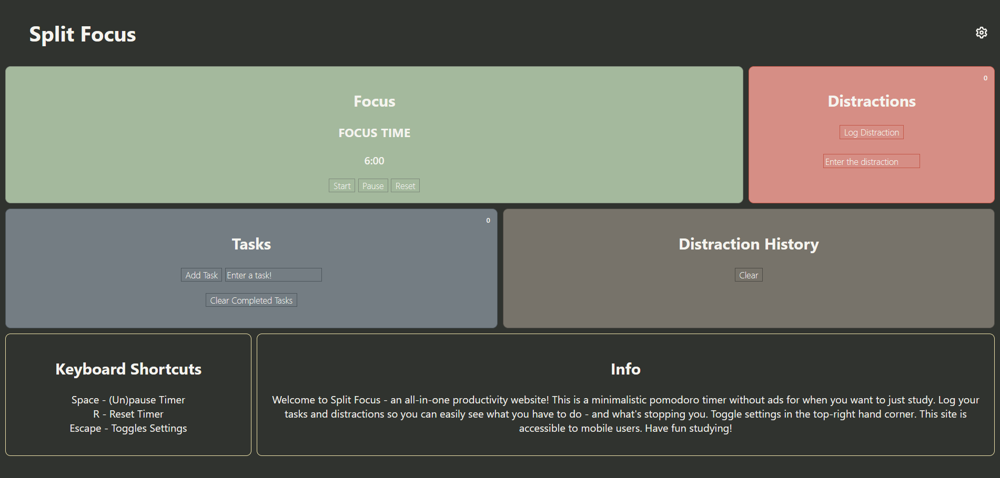

# Split Focus

Have you ever need a way to focus? Did you attention ever get split up between your work and distractions?

That's where Split Focus comes in. A low effort, minimalistic way to track your work, Split Focus makes taking breaks easy.
As the developer of the website, I struggle a lot with getting off track. The method that worked best for me was the Pomodoro method, where you could work for a set amount of time, take a short break, and work again for a set amount of time before taking a well-deserved long break.
But why choose Split Focus? Many Pomodoro timers across the web are made for profit, but not this one. Split Focus is made for the students on today, featuring no ads or paid features - everything has, is, and always will be free.

**Features**
- Pomodoro Timer with Customizable Intervals
- Focus Timer that doesn't Have Over-The-Top Transitions
- Distraction Tracker - Track Exactly what's Hindering Study Time and Log It
- Task Manager - Easily Access, Add, and Delete Tasks so You Don't Have to Keep Looking at an Agenda
- Persistence - Will not Reset after Every Reload / New Instance
- Keyboard Shortcuts for QoL

**Tech Used**
- HTML - Website Structure
- CSS - Style
- JS - For Functionality and Interactivit
- localStorage - Keeps Settings, Tasks, and Distractions from your Latest Instance
- Vite - Development Environment

**How to Run/Use**
*Web*
- Go to https://pokeglitched.github.io/split-focus/

*LocalHost/Clone*
- Clone repo
- Open project folder
- Install dependencies thru npm(.cmd) install
- Run npm(.cmd) run dev to get server link
- Open in browser
